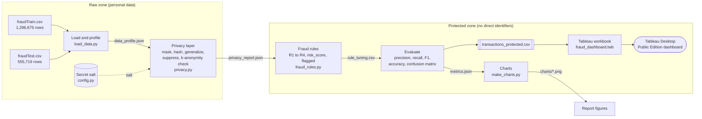
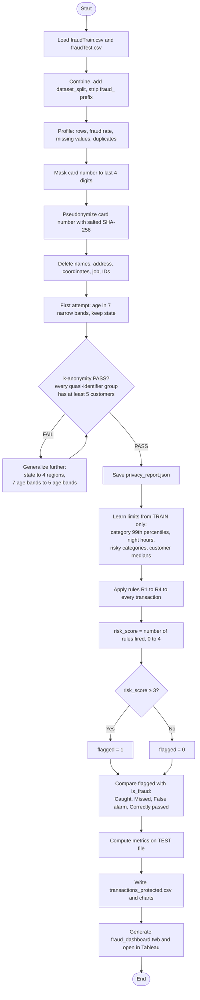

# Chapter 2. Project design and methodology

## 2.1 System overview

The system is a Python batch pipeline connected to a Tableau dashboard. It protects the private fields in 1.85 million card transactions, applies 4 fraud rules and gives Tableau only the protected result.

The pipeline has six steps, each in a separate module under `src/`. `src/run_pipeline.py` runs them in order.

| Step | Module | What it does | Main output |
|---|---|---|---|
| 1. Load | `load_data.py` | Reads both CSV files, combines them, cleans merchant names, profiles the data | `outputs/data_profile.json` |
| 2. Privacy layer | `privacy.py` | Masks and pseudonymizes the card number, generalizes date of birth and state, deletes other personal columns, checks k-anonymity | `outputs/privacy_report.json` |
| 3. Fraud rules | `fraud_rules.py` | Learns rule limits from the training file, applies 4 rules, computes the risk score | rule columns, `outputs/rule_tuning.csv` |
| 4. Evaluate | `fraud_rules.py` | Compares the rule decision with the true label on the test file | `outputs/metrics.json` |
| 5. Charts | `make_charts.py` | Draws figures for the report | `outputs/charts/*.png` |
| 6. Tableau workbook | `build_dashboard.py` | Writes the dashboard file that reads the protected CSV | `dashboard/fraud_dashboard.twb` |

Tableau reads only `data/processed/transactions_protected.csv`, never the raw files. `src/config.py` holds the file paths, secret salt and rule settings.

## 2.2 System architecture diagram

Figure 2.1 separates the *raw zone*, which contains personal data, from the *protected zone*, which contains only de-identified data.



**Figure 2.1: System architecture of the privacy-preserving fraud analytics pipeline**

The two Kaggle files enter the raw zone on the left. Step 1 combines them, records the source in `dataset_split` (`train` or `test`), removes the `fraud_` prefix from merchant names and saves a profile. Step 2 is the last part of the system allowed to touch names, addresses, dates of birth or full card numbers. It creates pseudonyms with the salt from `config.py` and checks k-anonymity before releasing any rows. Steps 3 and 4 use protected columns only. They learn the rule limits on training rows and measure the results on test rows. The Tableau workbook reads the protected CSV, including its rule results and `outcome` label. Step 5 supplies the Matplotlib figures used in this report.

## 2.3 Methodology flow chart

Figure 2.2 follows the data through the k-anonymity check and the risk score threshold.



**Figure 2.2: Methodology flow chart**

The first k-anonymity check fails. With state and 7 narrow age bands, 659 of the 999 customers fall into groups smaller than 5. Generalizing the data to 4 Census regions and 5 age bands raises the smallest group to 5, which passes the check. The pipeline saves both results for Chapter 4.

## 2.4 Algorithms used

### 2.4.1 Masking

The displayed value replaces `cc_num` with a fixed pattern containing only the last 4 digits, for example `**** **** **** 2095`. PCI DSS allows at most the BIN and the last four digits [7]. The analysis does not need the BIN, so the output omits it.

```text
function MASK(card_number):
    last4 = last 4 characters of card_number
    return "**** **** **** " + last4
```

### 2.4.2 Pseudonymization with salted SHA-256

NIST FIPS 180-4 defines the SHA-256 cryptographic hash function [17]. It converts an input into a 256-bit value written as 64 hexadecimal characters. The output does not directly reveal the input. Python provides SHA-256 through the standard `hashlib` module [18].

Card numbers have a limited, structured format. An attacker could hash possible numbers and compare the results. The pipeline first joins a secret *salt* to the card number, so the attacker cannot make the same comparison without that salt. This follows the GDPR definition of pseudonymisation, in which the "additional information" is kept separately [4]. For this project the salt is in `src/config.py`. A real deployment would keep it in a secrets vault.

```text
function PSEUDONYMIZE(card_number, SALT):
    digest = SHA256(SALT joined with card_number)    # 64 hex characters
    return "C_" + first 10 characters of digest       # e.g. C_3298fc2482
```

The same card produces the same `customer_id` in both files. Rule R4 can then compare a transaction with that customer's usual spending without using the card number. Ten hexadecimal characters allow 16^10, about 1.1 × 10^12, values. With 999 customers, the chance of two cards receiving the same code is about 1 in 2 million.

### 2.4.3 Generalization and suppression

Age is calculated from `dob` at the time of each transaction, then placed in one of 5 bands: `<25`, `25-39`, `40-54`, `55-69`, `70+`. The exact birth date is discarded.

The state code becomes one of the 4 US Census regions: Northeast, Midwest, South or West [19]. The exact state is discarded.

The pipeline deletes names (`first`, `last`), address fields (`street`, `city`, `zip`), coordinates (`lat`, `long`, `merch_lat`, `merch_long`), `city_pop`, `job`, `trans_num` and `unix_time`. These 13 fields either identify or help identify a person, or no rule needs them.

### 2.4.4 k-anonymity check

The quasi-identifiers (QI) are `age_band`, `gender` and `region`. Following Sweeney's definition [12], the check counts the number of *distinct customers* in every QI group. We count customers, not transactions, because one customer has many transactions, and counting rows would make groups look safer than they are.

```text
function K_ANONYMITY_CHECK(data, QI = [age_band, gender, region], k = 5):
    groups = data grouped by QI
    size   = number of distinct customer_id in each group
    exposed = number of customers in groups where size < k
    if min(size) >= k: return PASS, min(size), exposed
    else:              return FAIL, min(size), exposed
```

Five age bands, 2 genders and 4 regions produce no more than 40 groups. The check still has to confirm that each group contains at least 5 customers.

### 2.4.5 Percentile thresholds

The p-th percentile is the value below which p% of the observations fall. R1 uses the 99th amount percentile within each category because a usual `travel` amount differs from a usual `grocery_pos` amount. R4 uses each customer's median, or 50th percentile. A few large purchases do not pull the median upward as they would pull the mean. The training file supplies every percentile and median.

### 2.4.6 Fraud rules and risk score

| Rule | Fires when | Learned from train |
|---|---|---|
| **R1 High amount** | the amount is above the 99th percentile of its category | percentile per category |
| **R2 Night time** | the hour is 22, 23, 0, 1, 2 or 3 | the hours with a high fraud rate |
| **R3 Risky category** | the category's fraud rate is at least 2 times the overall rate | `grocery_pos`, `misc_net`, `shopping_net` |
| **R4 Above usual spend** | the amount is at least 5 times the customer's median spend | median per `customer_id` (falls back to the category median for unseen customers) |

Each rule returns 1 when it fires and 0 otherwise. Their sum is the risk score. A transaction is flagged when that score reaches the chosen threshold.

```text
# learning (TRAIN rows only)
p99[category]      = 99th percentile of amount per category
night_hours        = hours with fraud_rate >= 2 * overall_fraud_rate
risky_categories   = categories with fraud_rate >= 2 * overall_fraud_rate
median[customer]   = median amount per customer_id
median_cat[category] = median amount per category

# applying (every row, using the frozen values above)
R1 = amount > p99[category]
R2 = hour in night_hours
R3 = category in risky_categories
usual = median[customer_id] if known else median_cat[category]
R4 = amount >= 5 * usual
risk_score = R1 + R2 + R3 + R4                  # 0 to 4
flagged    = 1 if risk_score >= T else 0
```

The training data determines the night hours. Any hour with at least 2 times the overall fraud rate qualifies; the expected set is 22, 23, 0, 1, 2 and 3. The pipeline also tries every threshold T from 1 to 4 on the training file and keeps the one with the highest F1. The design value is **T = 3**. `outputs/rule_tuning.csv` stores the full comparison.

A tested fifth rule used the distance between the customer and merchant. It was dropped because the averages barely differ: 76.1 km for normal transactions and 76.3 km for fraud.

### 2.4.7 Evaluation metrics

Every test transaction has one of the four outcomes shown on the dashboard.

| | Actually fraud (`is_fraud` = 1) | Actually normal (`is_fraud` = 0) |
|---|---|---|
| **Flagged** (`flagged` = 1) | True Positive (TP): *Caught* | False Positive (FP): *False alarm* |
| **Not flagged** (`flagged` = 0) | False Negative (FN): *Missed* | True Negative (TN): *Correctly passed* |

From these four counts:

* **Precision** = TP / (TP + FP): of the flagged transactions, how many were really fraud.
* **Recall** = TP / (TP + FN): of all fraud, how much was caught.
* **F1 score** = 2 × Precision × Recall / (Precision + Recall): the balance of the two.
* **Accuracy** = (TP + TN) / (TP + TN + FP + FN): the share of all decisions that were correct.

Only 0.52% of all transactions are fraud, falling to 0.39% in the test file. A rule that flags nothing would classify every normal transaction correctly. Its test accuracy would be about 99.6%, despite 0% recall. Precision and recall are more useful on this imbalance [3], [20]. F1 selects the threshold, while the report gives precision and recall as the main results. The pipeline computes all metrics for each rule and for the combined score.

## 2.5 Tools and technologies

| Tool | Version / edition | Purpose in this project |
|---|---|---|
| Python | 3.13 | Main programming language for the pipeline |
| uv | current release | Creates the Python environment and installs packages from `pyproject.toml` and `uv.lock` [21] |
| pandas | 3.0.6 | Loading CSV files, grouping, percentiles, medians, writing the protected CSV [22] |
| NumPy | 2.5.3 | Fast numeric operations on columns |
| Matplotlib | 3.11.2 | Report charts (fraud by hour, by category, rule comparison, confusion matrix, k-anonymity group sizes) |
| hashlib | Python standard library | SHA-256 hashing for pseudonyms [18] |
| Tableau Desktop Public Edition | free edition | Opening, checking and saving the dashboard locally [9] |
| macOS on Apple Silicon | arm64 | Operating system and hardware platform |
| VS Code and terminal | n/a | Writing code and running the pipeline |
| Mermaid | n/a | Drawing the diagrams in this report as code |

`uv.lock` fixes the package versions for each run. `build_dashboard.py` generates the Tableau XML workbook (`.twb`), so a new run can rebuild the same dashboard.

## 2.6 Experimental setup environment

### Hardware and software

| Item | Details |
|---|---|
| Computer | MacBook Air |
| Processor architecture | Apple Silicon (arm64) |
| Operating system | macOS |
| Python | 3.13, managed by uv |
| Libraries | pandas 3.0.6, NumPy 2.5.3, Matplotlib 3.11.2 |
| Dashboard | Tableau Desktop Public Edition (workbook saved locally) |
| Data size on disk | about 502 MB of raw CSV (351 MB + 150 MB) |

### Train and test protocol

1. The dataset files follow each other in time. `fraudTrain.csv` covers 2019-01-01 to 2020-06-21, and `fraudTest.csv` covers 2020-06-21 to 2020-12-31. The rows are not shuffled. Testing on later data is closer to how a fraud system operates [3].
2. The training file supplies the category percentiles, night hours, risky categories, customer medians and score threshold.
3. Those values are fixed before the test file is processed. The test value of `is_fraud` never sets a rule.
4. Final metrics use all 555,719 test rows. Training metrics are used only to choose the threshold.
5. No step uses random numbers, and `config.py` contains a fixed salt. Repeated runs produce the same pseudonyms, rule results and metrics.

## 2.7 Dataset description

### Source

Kartik Shenoy published the "Credit Card Transactions Fraud Detection Dataset" on Kaggle under the CC0 public-domain licence: https://www.kaggle.com/datasets/kartik2112/fraud-detection [8]. Brandon Harris created the open-source Sparkov simulator used to generate it [8], [23]. Sparkov uses the Python Faker library and customer profiles based on factors such as age group, gender and urban or rural location. It produces fake customers, merchants, ordinary transactions and fraud [8], [23]. No row describes a real person. The columns resemble personal fields in bank data, so the file can be used to practise privacy protection without exposing customers.

Kaggle describes about 1,000 customers and a pool of 800 merchants [8]. The file profile finds 999 distinct cards and 693 merchant names in the actual rows.

### Dataset facts (measured by `src/load_data.py`)

| Fact | Value |
|---|---|
| Files | `fraudTrain.csv` (1,296,675 rows) and `fraudTest.csv` (555,719 rows) |
| Total rows | 1,852,394 |
| Period | Train: 2019-01-01 to 2020-06-21. Test: 2020-06-21 to 2020-12-31 |
| Fraud | 9,651 rows (0.52%). Train 0.58%, test 0.39% |
| Customers (cards) | 999 |
| States / categories / merchants | 51 / 14 / 693 |
| Missing values, duplicate rows | 0, 0 |
| Country, currency | USA, US dollars |
| Customer age at transaction | 13 to 96 |

The 14 categories are `entertainment`, `food_dining`, `gas_transport`, `grocery_net`, `grocery_pos`, `health_fitness`, `home`, `kids_pets`, `misc_net`, `misc_pos`, `personal_care`, `shopping_net`, `shopping_pos` and `travel`.

### Columns and how each is used or protected

Each file has 23 columns. Table 2.1 gives the privacy class and pipeline treatment for each one.

**Table 2.1: Raw columns, privacy class and treatment**

| Raw column | Meaning | Privacy class | Treatment | Output column |
|---|---|---|---|---|
| (unnamed first column) | Row number | Not needed | Dropped | none |
| `trans_date_trans_time` | Date and time of payment | Analytic | Kept | `transaction_time`, `hour` |
| `cc_num` | Full card number | Direct identifier | Masking and salted SHA-256 pseudonym | `card_masked`, `customer_id` |
| `merchant` | Merchant name | Analytic | Cleaned (strip `fraud_`) | `merchant` |
| `category` | Spending category (14 values) | Analytic | Kept | `category` |
| `amt` | Amount in US dollars | Analytic | Kept | `amount` |
| `first`, `last` | Customer first and last name | Direct identifier | Suppressed | none |
| `gender` | F or M | Quasi-identifier | Kept, checked in k-anonymity | `gender` |
| `street`, `city`, `zip` | Home address | Direct / strong quasi-identifier | Suppressed | none |
| `state` | US state (51 codes) | Quasi-identifier | Generalized to Census region | `region` |
| `lat`, `long` | Home coordinates | Strong quasi-identifier | Suppressed | none |
| `city_pop` | Population of home city | Quasi-identifier | Suppressed | none |
| `job` | Customer's job | Quasi-identifier | Suppressed | none |
| `dob` | Date of birth | Quasi-identifier | Generalized to age band | `age_band` |
| `trans_num` | Unique transaction ID | Linkable identifier | Suppressed | none |
| `unix_time` | Time as a number | Duplicate of time | Suppressed | none |
| `merch_lat`, `merch_long` | Merchant coordinates | Can reveal location | Suppressed (distance rule dropped) | none |
| `is_fraud` | True label (0 or 1) | Label | Kept for evaluation only | `is_fraud` |

The pipeline also adds new columns: `dataset_split`, the four rule columns, `risk_score`, `flagged` and `outcome`. The full layout of the protected file is described in Chapter 3.

### Data quirk: the `fraud_` merchant prefix

Every merchant name starts with `fraud_`, for example `fraud_Rippin, Kub and Mann`. The prefix comes from the simulator and is present on normal and fraudulent transactions. It is not a fraud label. The pipeline removes it before the dashboard sees the name, producing `Rippin, Kub and Mann`.

## References (Milestone 1: Chapters 1 and 2)

[1] The Nilson Report, "Payment Card Fraud Losses Approach $34 Billion," press release, Jan. 6, 2025. [Online]. Available: https://www.fintechfutures.com/press-releases/payment-card-fraud-losses-approach-34-billion

[2] R. J. Bolton and D. J. Hand, "Statistical fraud detection: A review," *Statistical Science*, vol. 17, no. 3, pp. 235-249, 2002, doi: 10.1214/ss/1042727940.

[3] A. Dal Pozzolo, O. Caelen, Y.-A. Le Borgne, S. Waterschoot, and G. Bontempi, "Learned lessons in credit card fraud detection from a practitioner perspective," *Expert Systems with Applications*, vol. 41, no. 10, pp. 4915-4928, 2014, doi: 10.1016/j.eswa.2014.02.026.

[4] European Parliament and Council of the European Union, "Regulation (EU) 2016/679 (General Data Protection Regulation)," Art. 4(1) and Art. 4(5), Apr. 27, 2016. [Online]. Available: https://eur-lex.europa.eu/eli/reg/2016/679/oj

[5] E. McCallister, T. Grance, and K. Scarfone, "Guide to protecting the confidentiality of personally identifiable information (PII)," NIST Special Publication 800-122, Apr. 2010, doi: 10.6028/NIST.SP.800-122.

[6] PCI Security Standards Council, "Securing the future of payments: PCI SSC publishes PCI Data Security Standard v4.0," press release, Mar. 31, 2022. [Online]. Available: https://www.pcisecuritystandards.org/about_us/press_releases/securing-the-future-of-payments-pci-ssc-publishes-pci-data-security-standard-v4-0/

[7] PCI Security Standards Council, "How can an entity meet PCI DSS requirements for PAN masking and truncation if it has migrated to 8-digit BINs?," FAQ 1492, Apr. 2024. [Online]. Available: https://www.pcisecuritystandards.org/faqs/1492/

[8] K. Shenoy, "Credit Card Transactions Fraud Detection Dataset," Kaggle, 2020. [Online]. Available: https://www.kaggle.com/datasets/kartik2112/fraud-detection

[9] Tableau, "Save workbooks to Tableau Public," Tableau Desktop Help. [Online]. Available: https://help.tableau.com/current/pro/desktop/en-us/publish_workbooks_tableaupublic.htm (accessed Oct. 8, 2026).

[10] Y.-A. Le Borgne, W. Siblini, B. Lebichot, and G. Bontempi, *Reproducible Machine Learning for Credit Card Fraud Detection: Practical Handbook*. Brussels, Belgium: Université Libre de Bruxelles, 2022. [Online]. Available: https://fraud-detection-handbook.github.io/fraud-detection-handbook/Chapter_2_Background/FDS.html

[11] S. Garfinkel, J. Near, A. Dajani, P. Singer, and B. Guttman, "De-identifying government datasets: Techniques and governance," NIST Special Publication 800-188, Sep. 2023, doi: 10.6028/NIST.SP.800-188.

[12] L. Sweeney, "k-anonymity: A model for protecting privacy," *International Journal of Uncertainty, Fuzziness and Knowledge-Based Systems*, vol. 10, no. 5, pp. 557-570, 2002, doi: 10.1142/S0218488502001648.

[13] A. Machanavajjhala, D. Kifer, J. Gehrke, and M. Venkitasubramaniam, "l-diversity: Privacy beyond k-anonymity," *ACM Transactions on Knowledge Discovery from Data*, vol. 1, no. 1, Art. 3, Mar. 2007, doi: 10.1145/1217299.1217302.

[14] C. Dwork, "Differential privacy," in *Automata, Languages and Programming (ICALP 2006)*, Lecture Notes in Computer Science, vol. 4052. Berlin, Germany: Springer, 2006, pp. 1-12, doi: 10.1007/11787006_1.

[15] Microsoft, "Download Power BI Desktop," Microsoft Learn. [Online]. Available: https://learn.microsoft.com/en-us/power-bi/fundamentals/desktop-get-the-desktop (accessed Oct. 8, 2026).

[16] B. Staniar, "Local file save with Tableau Desktop Public Edition," Tableau Blog, Apr. 30, 2024. [Online]. Available: https://www.tableau.com/en-gb/blog/local-file-save-tableau-desktop-public-edition

[17] National Institute of Standards and Technology, "Secure Hash Standard (SHS)," FIPS PUB 180-4, Aug. 2015, doi: 10.6028/NIST.FIPS.180-4.

[18] Python Software Foundation, "hashlib: Secure hashes and message digests," Python Documentation. [Online]. Available: https://docs.python.org/3/library/hashlib.html (accessed Oct. 8, 2026).

[19] National Center for Health Statistics, "Geographic division or region," Health, United States, Centers for Disease Control and Prevention. [Online]. Available: https://www.cdc.gov/nchs/hus/sources-definitions/geographic-region.htm (accessed Oct. 8, 2026).

[20] T. Saito and M. Rehmsmeier, "The precision-recall plot is more informative than the ROC plot when evaluating binary classifiers on imbalanced datasets," *PLOS ONE*, vol. 10, no. 3, Art. e0118432, 2015, doi: 10.1371/journal.pone.0118432.

[21] Astral, "uv: An extremely fast Python package and project manager," Documentation. [Online]. Available: https://docs.astral.sh/uv/ (accessed Oct. 8, 2026).

[22] pandas development team, "pandas documentation." [Online]. Available: https://pandas.pydata.org/docs/ (accessed Oct. 8, 2026).

[23] B. Harris, "Sparkov_Data_Generation," GitHub repository. [Online]. Available: https://github.com/namebrandon/Sparkov_Data_Generation (accessed Oct. 8, 2026).
