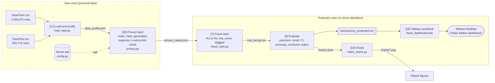

# Chapter 2. Project Design and Methodology

## 2.1 System Overview

The system is a batch pipeline written in Python, followed by a Tableau dashboard. It takes 1.85 million credit card transactions, hides the private customer details, flags suspicious transactions with 4 simple rules, and sends the protected result to Tableau.

The pipeline has six steps. Each step is a separate Python module in `src/`, and `src/run_pipeline.py` runs them in order.

| Step | Module | What it does | Main output |
|---|---|---|---|
| 1. Load | `load_data.py` | Reads both CSV files, combines them, cleans merchant names, profiles the data | `outputs/data_profile.json` |
| 2. Privacy layer | `privacy.py` | Masks and pseudonymizes the card number, generalizes date of birth and state, deletes other personal columns, checks k-anonymity | `outputs/privacy_report.json` |
| 3. Fraud rules | `fraud_rules.py` | Learns rule limits from the training file, applies 4 rules, computes the risk score | rule columns, `outputs/rule_tuning.csv` |
| 4. Evaluate | `fraud_rules.py` | Compares the rule decision with the true label on the test file | `outputs/metrics.json` |
| 5. Charts | `make_charts.py` | Draws figures for the report | `outputs/charts/*.png` |
| 6. Tableau workbook | `build_dashboard.py` | Writes the dashboard file that reads the protected CSV | `dashboard/fraud_dashboard.twb` |

The main design rule is that **Tableau only ever sees the protected file** (`data/processed/transactions_protected.csv`). It never sees the raw data. Settings such as file paths, the secret salt and rule settings are kept in one place, `src/config.py`.

## 2.2 System Architecture Diagram

Figure 2.1 shows the architecture. The dashed boundary separates the *raw zone*, where personal data exists, from the *protected zone*, where only de-identified data exists.



**Figure 2.1: System architecture of the privacy-preserving fraud analytics pipeline**

**Explanation.** The two raw Kaggle files enter on the left. Step 1 loads and combines them, adds a `dataset_split` column (`train` or `test`), strips the `fraud_` prefix from merchant names and saves a data profile. Step 2 is the privacy layer and the trust boundary of the system: it is the last step that touches names, addresses, dates of birth and full card numbers. It uses the secret salt from `config.py` to create pseudonyms, and it checks k-anonymity before any data leaves it. Steps 3 and 4 work only on the protected columns. The rules learn their limits from training rows and are then measured on test rows. The protected CSV, which includes the rule results and an `outcome` label, is the only input of the Tableau workbook. Matplotlib charts from step 5 are used as figures in this report.

## 2.3 Methodology Flow Chart

Figure 2.2 shows the order of work and the two main decision points: the k-anonymity check and the risk score threshold.


**Figure 2.2: Methodology flow chart**

The k-anonymity loop is part of the design story. The first, more detailed version of the data (state and 7 narrow age bands) fails the check, with 659 of the 999 customers in groups smaller than 5. The data is then generalized to 4 Census regions and 5 age bands, and the check passes, with a smallest group of 5 customers. Both checks are saved, so the report can show the failure and the fix (Chapter 4).

## 2.4 Algorithms Used

### 2.4.1 Masking

The full card number (`cc_num`) is replaced for display by a fixed pattern that keeps only the last 4 digits, for example `**** **** **** 2095`. This follows the PCI DSS display rule, which allows at most the BIN and the last four digits [6]. We keep fewer digits than allowed, because the analysis does not need the BIN.

```text
function MASK(card_number):
    last4 = last 4 characters of card_number
    return "**** **** **** " + last4
```

### 2.4.2 Pseudonymization with Salted SHA-256

SHA-256 is a cryptographic hash function defined in NIST FIPS 180-4 [17]. It turns any input into a fixed 256-bit value (64 hexadecimal characters). It is one-way: the input cannot be calculated from the output. Python provides it in the standard `hashlib` module [18].

A card number has a limited and structured format, so an attacker could hash every possible card number and compare the results. To stop this, a secret *salt* is joined to the card number before hashing. Without the salt, the attacker cannot rebuild the pseudonyms. This matches the GDPR definition of pseudonymisation, where the "additional information" (here, the salt) is kept separately [7]. In this project the salt is stored in `src/config.py`; in a real system it would be kept in a secret vault.

```text
function PSEUDONYMIZE(card_number, SALT):
    digest = SHA256(SALT joined with card_number)    # 64 hex characters
    return "C_" + first 10 characters of digest       # e.g. C_3298fc2482
```

The same card always gives the same `customer_id`, in both files. This lets rule R4 compare a transaction with the customer's usual spending without using the real card number. Ten hex characters give 16^10 (about 1.1 × 10^12) possible values, so for 999 customers the chance that two cards get the same code is about 1 in 2 million.

### 2.4.3 Generalization and Suppression

* **Age band.** Age is calculated from `dob` at the time of each transaction and then placed in one of 5 bands: `<25`, `25-39`, `40-54`, `55-69`, `70+`. The exact date of birth is not kept.
* **Region.** The state code is mapped to one of the 4 regions used by the US Census Bureau: Northeast, Midwest, South and West [19]. The exact state is not kept.
* **Suppression.** Names (`first`, `last`), address fields (`street`, `city`, `zip`), coordinates (`lat`, `long`, `merch_lat`, `merch_long`), `city_pop`, `job`, `trans_num` and `unix_time` are deleted. These 13 columns are either direct identifiers, strong quasi-identifiers, or not needed by any rule.

### 2.4.4 k-Anonymity Check

The quasi-identifiers (QI) are `age_band`, `gender` and `region`. Following Sweeney's definition [10], the check counts the number of *distinct customers* in every QI group. We count customers, not transactions, because one customer has many transactions, and counting rows would make groups look safer than they are.

```text
function K_ANONYMITY_CHECK(data, QI = [age_band, gender, region], k = 5):
    groups = data grouped by QI
    size   = number of distinct customer_id in each group
    exposed = number of customers in groups where size < k
    if min(size) >= k: return PASS, min(size), exposed
    else:              return FAIL, min(size), exposed
```

With 5 age bands, 2 genders and 4 regions, there are at most 40 groups, which is small enough for every group to contain several customers.

### 2.4.5 Percentile Thresholds

The p-th percentile of a list of numbers is the value below which p% of the numbers fall. Rule R1 uses the 99th percentile of the amount *within each category*, because a normal amount for `travel` is very different from a normal amount for `grocery_pos`. Rule R4 uses the *median* (50th percentile) of each customer's spending, because the median is not pulled up by a few large purchases. All percentiles and medians are calculated on the training file only.

### 2.4.6 Fraud Rules and Risk Score

| Rule | Fires when | Learned from train |
|---|---|---|
| **R1 High amount** | the amount is above the 99th percentile of its category | percentile per category |
| **R2 Night time** | the hour is 22, 23, 0, 1, 2 or 3 | the hours with a high fraud rate |
| **R3 Risky category** | the category's fraud rate is at least 2 times the overall rate | `grocery_pos`, `misc_net`, `shopping_net` |
| **R4 Above usual spend** | the amount is at least 5 times the customer's median spend | median per `customer_id` (falls back to the category median for unseen customers) |

Each rule gives 1 if it fires and 0 if not. The risk score is the number of rules that fire, and a transaction is flagged when the score reaches a threshold.

```text
# learning (TRAIN rows only)
p99[category]      = 99th percentile of amount per category
night_hours        = hours with fraud_rate >= 2 * overall_fraud_rate
risky_categories   = categories with fraud_rate >= 2 * overall_fraud_rate
median[customer]   = median amount per customer_id
median_cat[category] = median amount per category

# applying (every row, using the frozen values above)
R1 = amount > p99[category]
R2 = hour in night_hours
R3 = category in risky_categories
usual = median[customer_id] if known else median_cat[category]
R4 = amount >= 5 * usual
risk_score = R1 + R2 + R3 + R4                  # 0 to 4
flagged    = 1 if risk_score >= T else 0
```

The night hours are not typed in by hand: they are the hours that pass the 2 times test on the training data (the design expects 22, 23, 0, 1, 2 and 3). The threshold T is chosen on the training file by trying every value from 1 to 4 and keeping the one with the best F1 score. The design value is **T = 3**, and the full comparison is saved in `outputs/rule_tuning.csv`.

A fifth rule, based on the distance between the customer and the merchant, was tested and dropped. The average distance is 76.1 km for normal transactions and 76.3 km for fraud, so it does not separate the two groups.

### 2.4.7 Evaluation Metrics

Each test transaction falls into one of four outcomes, which are also shown on the dashboard.

| | Actually fraud (`is_fraud` = 1) | Actually normal (`is_fraud` = 0) |
|---|---|---|
| **Flagged** (`flagged` = 1) | True Positive (TP): *Caught* | False Positive (FP): *False alarm* |
| **Not flagged** (`flagged` = 0) | False Negative (FN): *Missed* | True Negative (TN): *Correctly passed* |

From these four counts:

* **Precision** = TP / (TP + FP): of the flagged transactions, how many were really fraud.
* **Recall** = TP / (TP + FN): of all fraud, how much was caught.
* **F1 score** = 2 × Precision × Recall / (Precision + Recall): the balance of the two.
* **Accuracy** = (TP + TN) / (TP + TN + FP + FN): the share of all decisions that were correct.

**Why accuracy is misleading here.** Only 0.52% of all transactions are fraud, and 0.39% of the test file. A "rule" that flags nothing at all would be right on every normal transaction, so its accuracy on the test file would be about 99.6%, while its recall would be 0%. On such imbalanced data, precision and recall give a much more honest picture than accuracy [20], [3]. This project therefore uses F1 to choose the threshold, and reports precision and recall as the main results. All metrics are computed for each rule alone and for the combined score.

## 2.5 Tools and Technologies

| Tool | Version / edition | Purpose in this project |
|---|---|---|
| Python | 3.13 | Main programming language for the pipeline |
| uv | current release | Creates the Python environment and installs packages from `pyproject.toml` and `uv.lock` [21] |
| pandas | 3.0.6 | Loading CSV files, grouping, percentiles, medians, writing the protected CSV [22] |
| NumPy | 2.5.3 | Fast numeric operations on columns |
| Matplotlib | 3.11.2 | Report charts (fraud by hour, by category, rule comparison, confusion matrix, k-anonymity group sizes) |
| hashlib | Python standard library | SHA-256 hashing for pseudonyms [18] |
| Tableau Desktop Public Edition | free edition | Opening, checking and saving the dashboard locally [15] |
| macOS on Apple Silicon | arm64 | Operating system and hardware platform |
| VS Code and terminal | n/a | Writing code and running the pipeline |
| Mermaid | n/a | Drawing the diagrams in this report as code |

The package versions are the ones fixed in `uv.lock`, so anyone who runs the project gets the same versions. The Tableau workbook (`.twb`) is an XML file, and it is generated by `build_dashboard.py` instead of being built by hand. This makes the dashboard consistent and easy to rebuild.

## 2.6 Experimental Setup Environment

### Hardware and software

| Item | Details |
|---|---|
| Computer | MacBook Air |
| Processor architecture | Apple Silicon (arm64) |
| Operating system | macOS |
| Python | 3.13, managed by uv |
| Libraries | pandas 3.0.6, NumPy 2.5.3, Matplotlib 3.11.2 |
| Dashboard | Tableau Desktop Public Edition (workbook saved locally) |
| Data size on disk | about 502 MB of raw CSV (351 MB + 150 MB) |

### Train and test protocol

1. **Time-based split.** The dataset already comes as two files that follow each other in time. `fraudTrain.csv` covers 2019-01-01 to 2020-06-21 and `fraudTest.csv` covers 2020-06-21 to 2020-12-31. We keep this split and do not shuffle the rows, so the rules are tested on *later* data, which is how a real fraud system is used [3].
2. **Learn on train only.** Every learned value (category percentiles, night hours, risky categories, customer medians and the score threshold) is computed from the training file only.
3. **Freeze and apply.** The learned values are then fixed and applied to the test file. The label `is_fraud` of test rows is never used to set any rule.
4. **Report on test.** Final metrics are reported on the 555,719 test rows, which the rules never saw. Training metrics are used only for choosing the threshold.
5. **Repeatability.** No step uses random numbers, and the salt is fixed in `config.py`, so running the pipeline again gives the same pseudonyms, rule results and metrics.

## 2.7 Dataset Description

### Source

The data is the **"Credit Card Transactions Fraud Detection Dataset"** published on Kaggle by Kartik Shenoy under the CC0 (public domain) licence, available at https://www.kaggle.com/datasets/kartik2112/fraud-detection [16]. It was generated with **Sparkov**, an open-source credit card transaction simulator created by Brandon Harris [16], [23]. Sparkov uses the Python library Faker and a set of customer profiles (for example, by age group, gender and urban or rural area) to create realistic but fake customers, merchants and transactions, including fraud [16], [23]. Because the data is simulated, **it describes no real people**. It still has the same kinds of personal columns as real bank data, which makes it suitable for practising privacy protection safely.

The Kaggle page describes the data as covering about 1,000 customers and a pool of 800 merchants [16]. Our own profile of the files finds 999 distinct cards and 693 distinct merchant names that actually appear in the data.

### Dataset facts (measured by `src/load_data.py`)

| Fact | Value |
|---|---|
| Files | `fraudTrain.csv` (1,296,675 rows) and `fraudTest.csv` (555,719 rows) |
| Total rows | 1,852,394 |
| Period | Train: 2019-01-01 to 2020-06-21. Test: 2020-06-21 to 2020-12-31 |
| Fraud | 9,651 rows (0.52%). Train 0.58%, test 0.39% |
| Customers (cards) | 999 |
| States / categories / merchants | 51 / 14 / 693 |
| Missing values, duplicate rows | 0, 0 |
| Country, currency | USA, US dollars |
| Customer age at transaction | 13 to 96 |

The 14 categories are `entertainment`, `food_dining`, `gas_transport`, `grocery_net`, `grocery_pos`, `health_fitness`, `home`, `kids_pets`, `misc_net`, `misc_pos`, `personal_care`, `shopping_net`, `shopping_pos` and `travel`.

### Columns and how each is used or protected

Each file has 23 columns. Table 2.1 lists them, classifies each one from a privacy point of view, and shows what the pipeline does with it.

**Table 2.1: Raw columns, privacy class and treatment**

| Raw column | Meaning | Privacy class | Treatment | Output column |
|---|---|---|---|---|
| (unnamed first column) | Row number | Not needed | Dropped | none |
| `trans_date_trans_time` | Date and time of payment | Analytic | Kept | `transaction_time`, `hour` |
| `cc_num` | Full card number | Direct identifier | Masking and salted SHA-256 pseudonym | `card_masked`, `customer_id` |
| `merchant` | Merchant name | Analytic | Cleaned (strip `fraud_`) | `merchant` |
| `category` | Spending category (14 values) | Analytic | Kept | `category` |
| `amt` | Amount in US dollars | Analytic | Kept | `amount` |
| `first`, `last` | Customer first and last name | Direct identifier | Suppressed | none |
| `gender` | F or M | Quasi-identifier | Kept, checked in k-anonymity | `gender` |
| `street`, `city`, `zip` | Home address | Direct / strong quasi-identifier | Suppressed | none |
| `state` | US state (51 codes) | Quasi-identifier | Generalized to Census region | `region` |
| `lat`, `long` | Home coordinates | Strong quasi-identifier | Suppressed | none |
| `city_pop` | Population of home city | Quasi-identifier | Suppressed | none |
| `job` | Customer's job | Quasi-identifier | Suppressed | none |
| `dob` | Date of birth | Quasi-identifier | Generalized to age band | `age_band` |
| `trans_num` | Unique transaction ID | Linkable identifier | Suppressed | none |
| `unix_time` | Time as a number | Duplicate of time | Suppressed | none |
| `merch_lat`, `merch_long` | Merchant coordinates | Can reveal location | Suppressed (distance rule dropped) | none |
| `is_fraud` | True label (0 or 1) | Label | Kept for evaluation only | `is_fraud` |

The pipeline also adds new columns: `dataset_split`, the four rule columns, `risk_score`, `flagged` and `outcome`. The full layout of the protected file is described in Chapter 3.

### Data quirk: the `fraud_` merchant prefix

Every merchant name in the dataset starts with `fraud_`, for example `fraud_Rippin, Kub and Mann`. This is a leftover of the simulator and **does not mean the transaction is fraud**. Both normal and fraud transactions have it. If it were left in, it could confuse dashboard users. The pipeline removes the prefix, so the name becomes `Rippin, Kub and Mann`.

## References

Reference numbers follow the consolidated list in Section 5.4.

[3] A. Dal Pozzolo, O. Caelen, Y.-A. Le Borgne, S. Waterschoot, and G. Bontempi, "Learned lessons in credit card fraud detection from a practitioner perspective," *Expert Systems with Applications*, vol. 41, no. 10, pp. 4915-4928, 2014, doi: 10.1016/j.eswa.2014.02.026.

[6] PCI Security Standards Council, "How can an entity meet PCI DSS requirements for PAN masking and truncation if it has migrated to 8-digit BINs?," FAQ 1492, Apr. 2024. [Online]. Available: https://www.pcisecuritystandards.org/faqs/1492/

[7] European Parliament and Council of the European Union, "Regulation (EU) 2016/679 (General Data Protection Regulation)," Art. 4(5), Apr. 27, 2016. [Online]. Available: https://eur-lex.europa.eu/eli/reg/2016/679/oj

[10] L. Sweeney, "k-anonymity: A model for protecting privacy," *International Journal of Uncertainty, Fuzziness and Knowledge-Based Systems*, vol. 10, no. 5, pp. 557-570, 2002, doi: 10.1142/S0218488502001648.

[15] Tableau, "Save workbooks to Tableau Public," Tableau Desktop Help. [Online]. Available: https://help.tableau.com/current/pro/desktop/en-us/publish_workbooks_tableaupublic.htm (accessed Oct. 8, 2026).

[16] K. Shenoy, "Credit Card Transactions Fraud Detection Dataset," Kaggle, 2020. [Online]. Available: https://www.kaggle.com/datasets/kartik2112/fraud-detection

[17] National Institute of Standards and Technology, "Secure Hash Standard (SHS)," FIPS PUB 180-4, Aug. 2015, doi: 10.6028/NIST.FIPS.180-4.

[18] Python Software Foundation, "hashlib: Secure hashes and message digests," Python Documentation. [Online]. Available: https://docs.python.org/3/library/hashlib.html (accessed Oct. 8, 2026).

[19] National Center for Health Statistics, "Geographic division or region," Health, United States, Centers for Disease Control and Prevention. [Online]. Available: https://www.cdc.gov/nchs/hus/sources-definitions/geographic-region.htm (accessed Oct. 8, 2026).

[20] T. Saito and M. Rehmsmeier, "The precision-recall plot is more informative than the ROC plot when evaluating binary classifiers on imbalanced datasets," *PLOS ONE*, vol. 10, no. 3, Art. e0118432, 2015, doi: 10.1371/journal.pone.0118432.

[21] Astral, "uv: An extremely fast Python package and project manager," Documentation. [Online]. Available: https://docs.astral.sh/uv/ (accessed Oct. 8, 2026).

[22] pandas development team, "pandas documentation." [Online]. Available: https://pandas.pydata.org/docs/ (accessed Oct. 8, 2026).

[23] B. Harris, "Sparkov_Data_Generation," GitHub repository. [Online]. Available: https://github.com/namebrandon/Sparkov_Data_Generation (accessed Oct. 8, 2026).
