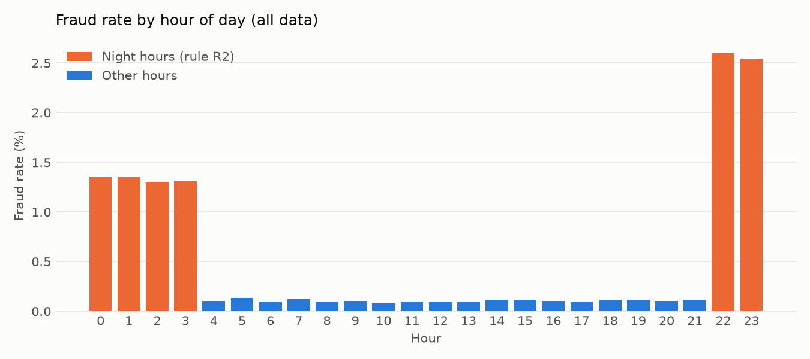
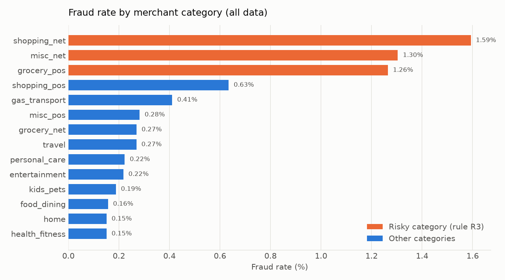
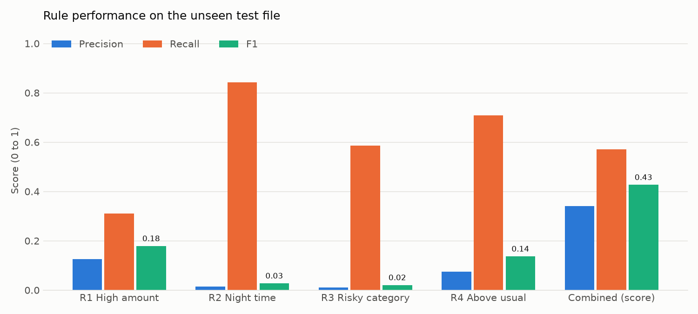
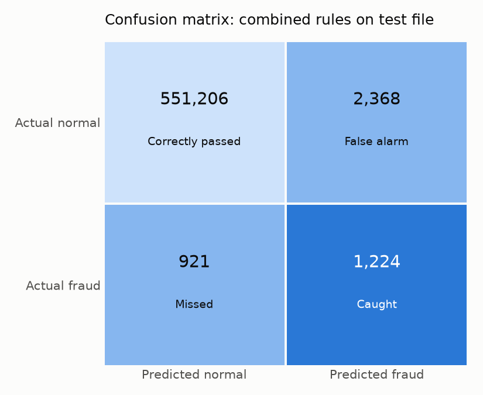
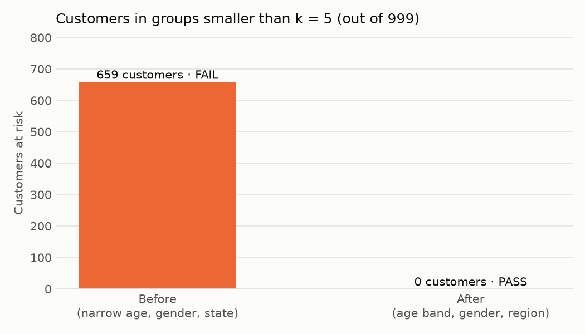
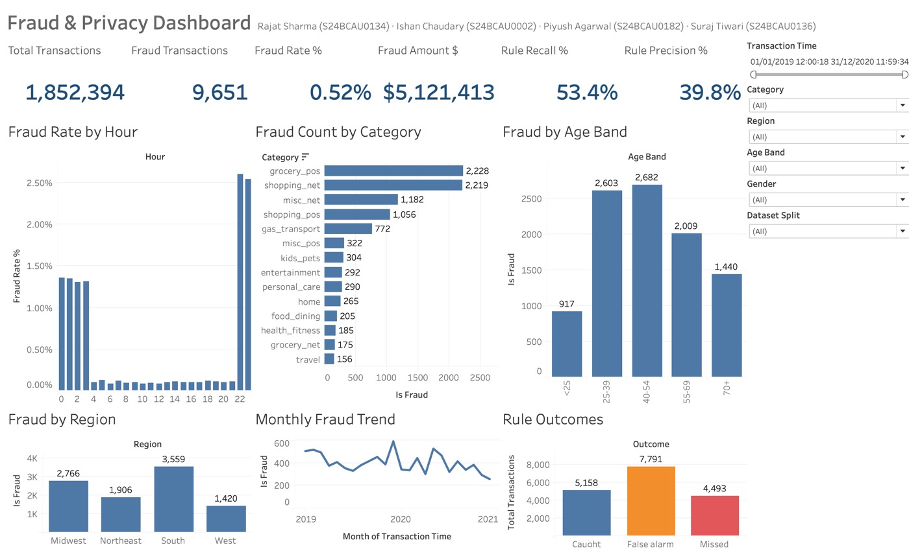
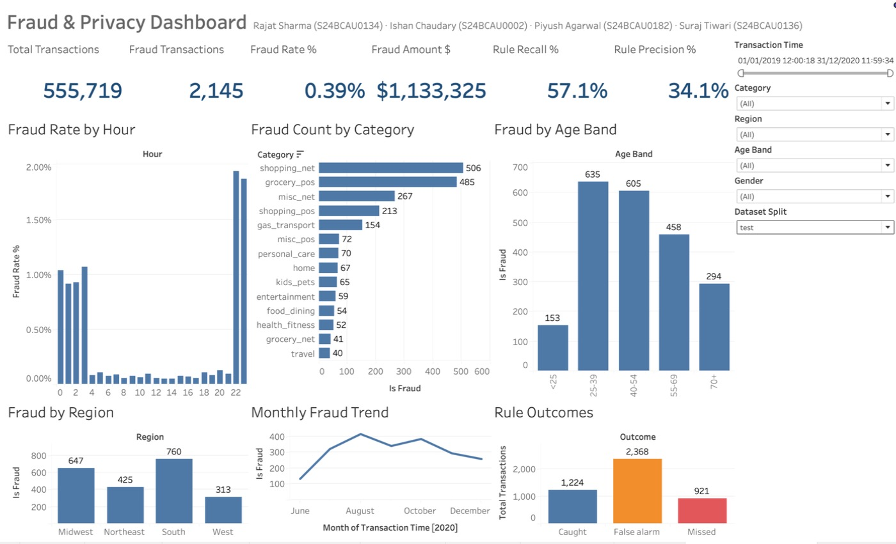

# Chapter 3. Project Implementation

This chapter explains how the design of Chapter 2 was turned into working code. All code is in the `src/` folder. Reference numbers in Chapters 3 to 5 refer to the consolidated list in Section 5.4.

## 3.1 Development Environment

| Item | Version / detail | Role |
|---|---|---|
| Computer | MacBook Air, Apple Silicon (arm64), macOS | Development and running the pipeline |
| Python | 3.13.15 | Programming language |
| uv | installed on the Mac | Creates the virtual environment and installs the locked packages [21] |
| pandas | 3.0.6 | Data loading, grouping, percentiles, CSV output [22] |
| NumPy | 2.5.3 | Numeric support for pandas [26] |
| Matplotlib | 3.11.2 | Report charts [25] |
| hashlib, xml.etree.ElementTree, csv, json | Python standard library | SHA-256 hashing [18], writing the Tableau XML [24], reading/writing files |
| Tableau Desktop Public Edition | free edition, workbook saved locally | Opening and using the dashboard [13], [15] |
| Editor | VS Code and the macOS terminal | Writing and running code |

The project is a uv project. `pyproject.toml` lists the three libraries, `uv.lock` fixes their exact versions, and `.python-version` asks for Python 3.13. The whole project is set up and run with two commands from the project folder:

```bash
uv sync                               # create .venv and install the locked packages
uv run python src/run_pipeline.py     # run steps 1 to 6
```

The Tableau workbook can also be rebuilt on its own with `uv run python src/build_dashboard.py`, once the protected CSV exists.

The folders used by the code are:

```text
cbca-293-security/
├── data/raw/            fraudTrain.csv, fraudTest.csv (Kaggle, never changed)
├── data/processed/      transactions_protected.csv (the only file Tableau reads)
├── src/                 the 7 Python modules
├── outputs/             data_profile.json, privacy_report.json, rule_tuning.csv,
│                        metrics.json, charts/*.png
├── dashboard/           fraud_dashboard.twb, screenshots/
└── reports/             this report
```

## 3.2 Module Description

Each step of the pipeline is a separate module, so each one can be read and tested on its own. Table 3.1 summarises them.

**Table 3.1: Modules of the system**

| Module | Step | Input | Output | Main functions |
|---|---|---|---|---|
| `config.py` | Settings | none | Settings used by all modules | `SALT`, `K_ANONYMITY`, `AGE_BINS`, `NARROW_AGE_BINS`, `STATE_TO_REGION`, rule settings |
| `load_data.py` | 1. Load | `data/raw/*.csv` | Combined table, `outputs/data_profile.json` | `load_raw()`, `profile()` |
| `privacy.py` | 2. Privacy layer | Combined raw table | Protected table, `outputs/privacy_report.json` | `mask_card()`, `pseudonymize()`, `age_at_transaction()`, `k_anonymity()`, `protect()` |
| `fraud_rules.py` | 3. Rules, 4. Evaluate | Protected table | Rule columns, `outputs/rule_tuning.csv`, `outputs/metrics.json` | `learn_limits()`, `apply_rules()`, `score()`, `tune_threshold()`, `evaluate()`, `add_decision()` |
| `make_charts.py` | 5. Charts | Protected table, limits, metrics, privacy report | 5 PNG files in `outputs/charts/` | `fraud_by_hour()`, `fraud_by_category()`, `rule_comparison()`, `confusion_matrix()`, `k_anonymity()` |
| `build_dashboard.py` | 6. Tableau workbook | `transactions_protected.csv` | `dashboard/fraud_dashboard.twb` | `build_datasource()`, `build_shared_views()`, `build_worksheet()`, `build_dashboard()`, `build()`, `validate()` |
| `run_pipeline.py` | All | Raw files | All outputs | `main()`, `save_json()` |

All settings live in `config.py`. For example, the secret salt, k = 5, the age bands, the state-to-region map and the rule factors (99th percentile, 2 times the overall fraud rate, 5 times the usual spend) are defined there and imported by the other modules.

## 3.3 Code Implementation

The excerpts below are copied from the source files. Comments in the code explain each step for a junior reader.

### 3.3.1 Loading and cleaning (`load_data.py`)

```python
for split, path in config.RAW_FILES.items():
    df = pd.read_csv(path, usecols=RAW_COLUMNS,
                     dtype={c: "category" for c in CATEGORY_COLUMNS})
    df["dataset_split"] = split
    parts.append(df)
df = pd.concat(parts, ignore_index=True)
...
df["merchant"] = df["merchant"].astype(str).str.removeprefix("fraud_")
```

Both files are read and stacked into one table, and a new column `dataset_split` remembers which file each row came from. The unnamed row-number column is skipped by `usecols`. Text columns with few distinct values are stored as the pandas `category` type to save memory. The simulator's `fraud_` prefix is removed from every merchant name.

### 3.3.2 Masking (`privacy.py`)

```python
def mask_card(card_number: int) -> str:
    """Keep only the last 4 digits, like a printed receipt."""
    return "**** **** **** " + str(card_number)[-4:]
```

Only the last four digits are kept, which is within the PCI DSS display rule [6]. The output always has the same shape, whatever the length of the original number.

### 3.3.3 Pseudonymization with salted SHA-256 (`privacy.py`)

```python
def pseudonymize(card_number: int, salt: str = config.SALT) -> str:
    digest = hashlib.sha256((salt + str(card_number)).encode("utf-8")).hexdigest()
    return "C_" + digest[:10]
```

The salt is placed in front of the card number and the result is hashed with SHA-256 [17], [18]. The first 10 hex characters become the `customer_id`, for example `C_3298fc2482`. In `protect()`, each of the 999 distinct cards is hashed once and the result is mapped to all of its rows, which is much faster than hashing 1.85 million rows.

### 3.3.4 Generalization (`privacy.py` and `config.py`)

```python
AGE_BINS = [0, 24, 39, 54, 69, 200]
AGE_LABELS = ["<25", "25-39", "40-54", "55-69", "70+"]
...
age = age_at_transaction(raw)
df["age_band"] = pd.cut(age, config.AGE_BINS, labels=config.AGE_LABELS)
df["region"] = raw["state"].astype(str).map(config.STATE_TO_REGION)
```

Age is calculated in whole years at the time of each transaction (days between birth date and transaction date, divided by 365.25). `pd.cut` puts each age into one of the 5 bands. Each state code is replaced by its US Census region [19]. The protected table is built column by column from the raw table, so any column that is not copied (names, address, coordinates, job, and so on) is suppressed automatically.

### 3.3.5 k-anonymity check (`privacy.py`)

```python
def k_anonymity(df: pd.DataFrame, quasi_identifiers: list[str], k: int = config.K_ANONYMITY) -> dict:
    sizes = df.groupby(quasi_identifiers, observed=True)["customer_id"].nunique()
    small = sizes[sizes < k]
    exposed = df.loc[df.set_index(quasi_identifiers).index.isin(small.index), "customer_id"].nunique()
    return {
        ...
        "result": "PASS" if sizes.min() >= k else "FAIL",
    }
```

The function groups the data by the quasi-identifiers and counts **distinct customers**, not rows, in each group [10]. Groups smaller than k are listed, and the customers inside them are counted as "exposed". `protect()` calls it twice: once on (narrow age band, gender, state) and once on (age band, gender, region).

### 3.3.6 Learning the rule limits (`fraud_rules.py`)

```python
def learn_limits(train: pd.DataFrame) -> RuleLimits:
    overall = train["is_fraud"].mean()
    hour_rate = train.groupby("hour")["is_fraud"].mean()
    cat_rate = train.groupby("category", observed=True)["is_fraud"].mean()
    return RuleLimits(
        overall_fraud_rate=float(overall),
        category_p99=train.groupby("category", observed=True)["amount"]
                          .quantile(config.HIGH_AMOUNT_PERCENTILE).to_dict(),
        night_hours=sorted(int(h) for h in hour_rate[hour_rate >= config.RISK_FACTOR * overall].index),
        risky_categories=sorted(str(c) for c in cat_rate[cat_rate >= config.RISK_FACTOR * overall].index),
        customer_median=train.groupby("customer_id")["amount"].median().to_dict(),
        category_median=train.groupby("category", observed=True)["amount"].median().to_dict(),
    )
```

This function only ever receives the training rows. It learns the 99th percentile amount of each category, the hours and categories whose fraud rate is at least 2 times the overall rate, and the median spend of each customer and each category. Note that the night hours are not typed in by hand: they are the hours that pass the 2 times test on the training data.

### 3.3.7 Applying the rules (`fraud_rules.py`)

```python
usual = df["customer_id"].map(limits.customer_median).fillna(category.map(limits.category_median))
df["rule_high_amount"] = (df["amount"] > category.map(limits.category_p99)).astype(int)
df["rule_night"] = df["hour"].isin(limits.night_hours).astype(int)
df["rule_risky_category"] = category.isin(limits.risky_categories).astype(int)
df["rule_above_usual"] = (df["amount"] >= config.ABOVE_USUAL_FACTOR * usual).astype(int)
df["risk_score"] = df[RULE_COLUMNS].sum(axis=1)
```

Each rule is one line and gives 0 or 1. A customer who has no training history gets the category median as their "usual" spend (`fillna`). The risk score is the sum of the four rule columns.

### 3.3.8 Scoring and threshold tuning (`fraud_rules.py`)

```python
def score(predicted: pd.Series, actual: pd.Series) -> dict:
    p, a = predicted.astype(bool), actual.astype(bool)
    tp, fp = int((p & a).sum()), int((p & ~a).sum())
    fn, tn = int((~p & a).sum()), int((~p & ~a).sum())
    precision = tp / (tp + fp) if tp + fp else 0.0
    recall = tp / (tp + fn) if tp + fn else 0.0
    f1 = 2 * precision * recall / (precision + recall) if precision + recall else 0.0
```

`score()` builds the confusion matrix and the four metrics from Section 2.4.7, and avoids division by zero. `tune_threshold()` calls it on the training rows for thresholds 1 to 4 and keeps the one with the highest F1. `evaluate()` calls it on the test rows for each rule, for the combined decision, and for a "flag nothing" baseline (written as `risk_score > 99`, which is never true). Finally, `add_decision()` adds `flagged` and the readable `outcome` label (`Caught`, `Missed`, `False alarm`, `Correctly passed`).

### 3.3.9 Keeping raw data out of later steps (`run_pipeline.py`)

```python
df, privacy_report = privacy.protect(raw)
del raw  # the raw data is not used after this point
```

After the privacy layer, the raw table is deleted from memory. Steps 3 to 6 can only use the protected table, which enforces the trust boundary shown in Figure 2.1. The protected CSV is written with exactly 19 columns (Section 4.2).

### 3.3.10 Generating and validating the Tableau workbook (`build_dashboard.py`)

A Tableau workbook (`.twb`) is an XML text file. Instead of building the dashboard by hand, `build_dashboard.py` writes this XML with Python's `xml.etree.ElementTree` module [24]. This makes the dashboard consistent and rebuildable with one command. The script defines:

* the **data source**: a text connection to `transactions_protected.csv` and its 19 columns;
* six **calculated fields** for the KPIs, written in Tableau's formula language, for example:

```python
"recall": Calc("Calculation_7310000000000000005", "Rule Recall %", "real",
               "SUM([flagged] * [is_fraud]) / SUM([is_fraud])", FMT_PCT1),
"precision": Calc("Calculation_7310000000000000006", "Rule Precision %", "real",
                  "SUM([flagged] * [is_fraud]) / SUM([flagged])", FMT_PCT1),
```

* six **shared filters** (date range, category, region, age band, gender, dataset split), stored so that they apply to all worksheets that use the data source;
* twelve **worksheets**: 6 KPI tiles (Total Transactions, Fraud Transactions, Fraud Rate %, Fraud Amount $, Rule Recall %, Rule Precision %) and 6 charts (Fraud Rate by Hour, Fraud Count by Category, Fraud by Age Band, Fraud by Region, Monthly Fraud Trend, Rule Outcomes);
* one **dashboard**, "Fraud & Privacy Dashboard", with a fixed size of 1400 x 900 pixels: a title, a row of 6 KPI tiles, a 2 x 3 grid of charts and a filter panel on the right.

The "Rule Outcomes" chart hides the very large `Correctly passed` group, so the `Caught`, `Missed` and `False alarm` bars can be compared. The "Fraud by Age Band" chart uses a manual order, because alphabetical order would put `<25` last.

After writing the file, `build()` calls `validate()`, which reads the XML back and checks it. It confirms that the XML parses, every field used on a shelf, filter or calculation is defined, each worksheet declares the fields it uses, every worksheet is placed on the dashboard, every layout zone sits inside its parent, and every sheet has a tab. If any check fails, the script stops with an error. On the final run it printed: `Validated fraud_dashboard.twb: 12 worksheets, 6 calculated fields, 6 shared filters.`

The workbook stores the folder of the CSV file as an absolute path. If the workbook is opened on another computer, it can be rebuilt with the option `--tableau-data-dir` so that Tableau looks in the right folder.

## 3.4 System Interface / Screenshots

### 3.4.1 Pipeline console output

The pipeline is run from the terminal with `uv run python src/run_pipeline.py`. The full output of the final run is shown below.

```text
[1/6] Loading raw Kaggle files ...
   1,852,394 rows, 9,651 fraud (0.52%)
   saved outputs/data_profile.json
[2/6] Privacy layer: mask, hash, generalize, suppress ...
   k-anonymity before: FAIL (smallest group 1, 659 customers in groups < 5)
   k-anonymity after: PASS (smallest group 5, 0 customers in groups < 5)
   saved outputs/privacy_report.json
[3/6] Learning rule limits from the TRAIN file ...
   night hours [0, 1, 2, 3, 22, 23], risky categories ['grocery_pos', 'misc_net', 'shopping_net']
   best threshold on train: risk_score >= 3
[4/6] Evaluating on the unseen TEST file ...
   precision 34.1%, recall 57.1%, F1 0.427
   saved outputs/metrics.json
[5/6] Drawing report charts ...
   saved outputs/charts/*.png
[6/6] Writing protected CSV and Tableau workbook ...
   saved data/processed/transactions_protected.csv
Validated fraud_dashboard.twb: 12 worksheets, 6 calculated fields, 6 shared filters.
   saved dashboard/fraud_dashboard.twb
Done in 114 seconds.
```

**Figure 3.1: Console output of the complete pipeline run**

The whole run, from 1.85 million raw rows to the finished Tableau workbook, took 114 seconds on the MacBook Air.

### 3.4.2 Report charts produced by the pipeline



**Figure 3.2: Fraud rate by hour of day (all data). Orange bars are the night hours learned for rule R2.**



**Figure 3.3: Fraud rate by merchant category (all data). Orange bars are the risky categories learned for rule R3.**



**Figure 3.4: Precision, recall and F1 of each rule and of the combined score on the test file**



**Figure 3.5: Confusion matrix of the combined rules on the test file**



**Figure 3.6: Customers in groups smaller than k = 5, before and after generalization**

These charts are discussed in Chapter 4.

### 3.4.3 Tableau dashboard

The workbook `dashboard/fraud_dashboard.twb` is opened in Tableau Desktop Public Edition. Figure 3.7 shows the full dashboard with all data, and Figure 3.8 shows the same dashboard with the Dataset Split filter set to `test`, so the KPIs match the test results in Chapter 4.

<!-- screenshot pending: capture after opening in Tableau -->


**Figure 3.7: Fraud & Privacy Dashboard, all data (train and test)**

<!-- screenshot pending: capture after opening in Tableau -->


**Figure 3.8: Fraud & Privacy Dashboard with Dataset Split = test**

The dashboard has three parts. The top row shows the 6 KPI tiles. The middle and bottom rows show the 6 charts. The right panel holds the 6 filters, and every filter changes all KPIs and charts at the same time. The dashboard only shows protected fields: the customer appears as a pseudonym and a masked card number, the location as a region and the age as a band.
