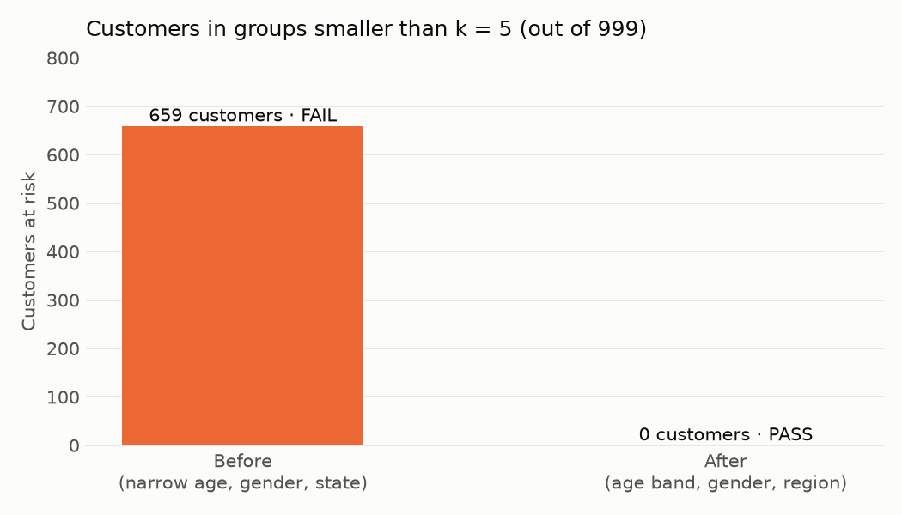
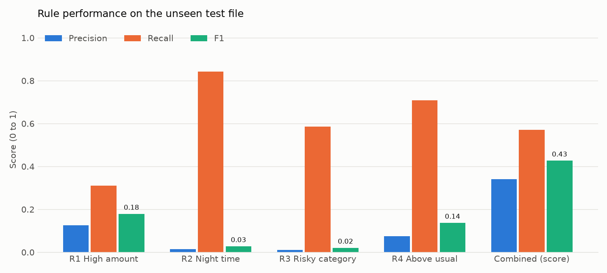
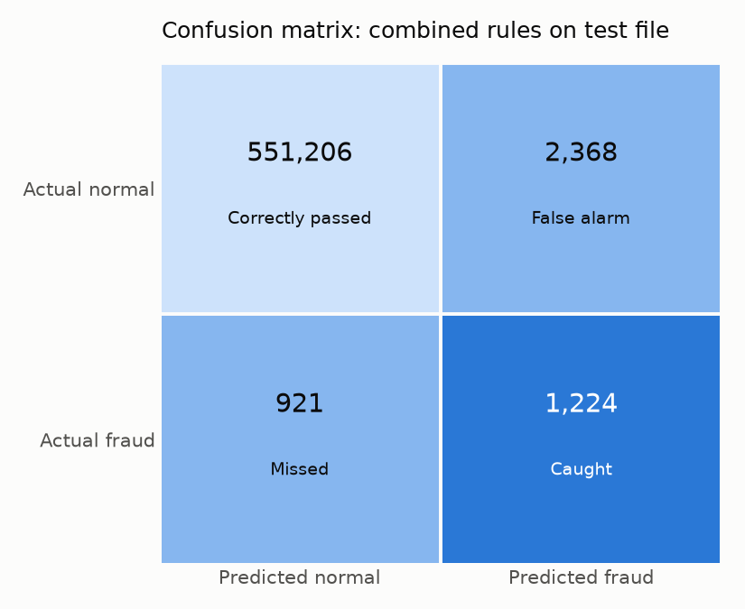

# Chapter 4. Results and Discussion

This chapter reports the results of the final pipeline run. Every number comes from the files in `outputs/`, from the console output in Figure 3.1, or (where stated) from counting rows in the protected CSV file.

## 4.1 Experimental Setup

The experiment follows the protocol set in Section 2.6.

| Item | Value |
|---|---|
| Hardware | MacBook Air, Apple Silicon (arm64), macOS |
| Software | Python 3.13.15, pandas 3.0.6, NumPy 2.5.3, Matplotlib 3.11.2, run with uv |
| Training data | `fraudTrain.csv`: 1,296,675 rows, 7,506 fraud (0.58%), 2019-01-01 00:00:18 to 2020-06-21 12:13:37 |
| Test data | `fraudTest.csv`: 555,719 rows, 2,145 fraud (0.39%), 2020-06-21 12:14:25 to 2020-12-31 23:59:34 |
| Split | By time, as given by the two files. No shuffling. |
| Learned from train only | Overall fraud rate, category 99th percentiles, night hours, risky categories, customer medians, category medians, score threshold |
| Reported on | Test rows only |
| Run time | 114 seconds for all six steps |

The test file starts 48 seconds after the training file ends, so the rules are always tested on *later* transactions than the ones they learned from.

### What was learned from the training file

The overall fraud rate in the training file is 0.5789% (`metrics.json`). Rules R2 and R3 call an hour or a category "risky" if its fraud rate is at least 2 times this value, that is at least 1.158%.

**Table 4.1: Rule limits learned from the training file**

| Rule | Learned value | Evidence |
|---|---|---|
| R1 High amount | One 99th percentile amount per category (14 limits) | Kept in memory by `learn_limits()` |
| R2 Night time | Hours 0, 1, 2, 3, 22 and 23 | `metrics.json`, console |
| R3 Risky category | `grocery_pos`, `misc_net`, `shopping_net` | `metrics.json`, console |
| R4 Above usual spend | Median spend of each of the 983 customers in the training file; category median for others | Counted from the protected CSV |

Counting the training rows of the protected CSV shows why these hours and categories were chosen. The six night hours have training fraud rates between 1.42% and 2.88% (highest at hour 22), while every other hour is between 0.10% and 0.14%. The three risky categories have training fraud rates of 1.76% (`shopping_net`), 1.45% (`misc_net`) and 1.41% (`grocery_pos`). The next category, `shopping_pos`, has 0.72%, which is below the 1.158% limit. The test file contains 924 customers, and 16 of them do not appear in the training file, so rule R4 uses the category median for those 16.

### Threshold tuning on the training file

The risk score threshold was chosen by trying every value from 1 to 4 on the training rows (`outputs/rule_tuning.csv`).

**Table 4.2: Threshold tuning on the training file (1,296,675 rows, 7,506 fraud)**

| Threshold (flag if risk_score ≥) | Flagged | TP | FP | FN | Precision | Recall | F1 | Accuracy |
|---|---|---|---|---|---|---|---|---|
| 1 | 530,962 | 7,208 | 523,754 | 298 | 1.36% | 96.03% | 0.0268 | 59.58% |
| 2 | 108,984 | 5,411 | 103,573 | 2,095 | 4.96% | 72.09% | 0.0929 | 91.85% |
| **3** | **9,357** | **3,934** | **5,423** | **3,572** | **42.04%** | **52.41%** | **0.4666** | **99.31%** |
| 4 | 1,485 | 1,237 | 248 | 6,269 | 83.30% | 16.48% | 0.2752 | 99.50% |

Threshold 3 has the highest F1 (0.4666), so the pipeline selected **risk_score ≥ 3**. This matches the design value in Section 2.4.6. The table also shows the trade-off clearly: a low threshold catches almost all fraud but raises hundreds of thousands of false alarms, and a high threshold is very precise but misses most fraud.

## 4.2 Output Results

### 4.2.1 Dataset profile

The facts measured by `load_data.py` (`outputs/data_profile.json`) match the dataset description in Section 2.7.

| Fact | Value |
|---|---|
| Total rows | 1,852,394 |
| Fraud rows | 9,651 (0.52%) |
| Missing values | 0 |
| Duplicate rows (full row) | 0 |
| Duplicate transaction IDs | 0 |
| Customers (cards) | 999 |
| States / categories / merchants | 51 / 14 / 693 |
| Customer age at transaction | 13 to 96 |

### 4.2.2 Privacy results: one record before and after

Table 4.3 shows the first record of the dataset before and after the privacy layer (`outputs/privacy_report.json`). The data is simulated, so this is not a real person.

**Table 4.3: Example record before and after the privacy layer**

| Field | Before (raw) | After (protected) | Technique |
|---|---|---|---|
| Card number | `2703186189652095` | `**** **** **** 2095` | Masking |
| Customer identifier | (the card number) | `C_3298fc2482` | Salted SHA-256 pseudonym |
| Name | Jennifer Banks | removed | Suppression |
| Date of birth | 1988-03-09 | `25-39` | Generalization to age band |
| Street, city, ZIP | 561 Perry Cove, Moravian Falls, 28654 | removed | Suppression |
| State | NC | South | Generalization to Census region |

The privacy report lists 16 raw columns that do not reach the output in their original form. Thirteen are suppressed completely (`first`, `last`, `street`, `city`, `zip`, `lat`, `long`, `city_pop`, `job`, `merch_lat`, `merch_long`, `trans_num`, `unix_time`), and three are replaced by safer versions (`cc_num` by `card_masked` and `customer_id`, `dob` by `age_band`, `state` by `region`).

### 4.2.3 k-anonymity before and after generalization

**Table 4.4: k-anonymity check with k = 5 (999 customers)**

| Measure | Before | After |
|---|---|---|
| Quasi-identifiers | narrow age band (7 bands), gender, state | age band (5 bands), gender, region |
| Number of groups | 461 | 40 |
| Smallest group (customers) | 1 | 5 |
| Groups smaller than 5 | 395 | 0 |
| Customers in groups smaller than 5 | 659 (66% of 999) | 0 |
| Result | **FAIL** | **PASS** |

**Figure 4.1: Customers in groups smaller than k = 5, before and after generalization**

With exact states and narrow age bands, the data splits into 461 small groups. 395 of them have fewer than 5 customers, and the smallest has just one, which means that customer could be singled out from age, gender and state alone. After generalizing to 4 regions and 5 age bands, there are 40 groups (5 x 2 x 4, so every possible combination occurs), the smallest has exactly 5 customers, and no customer is exposed. Objective 4 is met.

### 4.2.4 Files produced

| Output | Content |
|---|---|
| `data/processed/transactions_protected.csv` | 1,852,394 rows, 19 columns, about 265 MB. The only input of Tableau. |
| `outputs/data_profile.json` | Dataset facts (Section 4.2.1) |
| `outputs/privacy_report.json` | k-anonymity before and after, example record, removed columns |
| `outputs/rule_tuning.csv` | Table 4.2 |
| `outputs/metrics.json` | Learned rule settings and all test metrics (Section 4.3) |
| `outputs/charts/*.png` | Figures 3.2 to 3.6 |
| `dashboard/fraud_dashboard.twb` | Tableau workbook: 12 worksheets, 6 calculated fields, 6 shared filters, validated |

The 19 columns of the protected CSV are exactly the ones listed in `docs/01_project_understanding.md`, section 4: `transaction_time`, `hour`, `dataset_split`, `customer_id`, `card_masked`, `merchant`, `category`, `amount`, `gender`, `age_band`, `region`, the four rule columns, `risk_score`, `flagged`, `is_fraud` and `outcome`.

## 4.3 Performance Analysis

### 4.3.1 Test results for each rule and the combined score

**Table 4.5: Results on the unseen test file (555,719 rows, 2,145 fraud)**

| Rule | Flagged | TP (caught) | FP (false alarms) | FN (missed) | Precision | Recall | F1 | Accuracy |
|---|---|---|---|---|---|---|---|---|
| R1 High amount | 5,315 | 666 | 4,649 | 1,479 | 12.53% | 31.05% | 0.1786 | 98.90% |
| R2 Night time | 130,139 | 1,807 | 128,332 | 338 | 1.39% | 84.24% | 0.0273 | 76.85% |
| R3 Risky category | 121,699 | 1,258 | 120,441 | 887 | 1.03% | 58.65% | 0.0203 | 78.17% |
| R4 Above usual spend | 20,073 | 1,518 | 18,555 | 627 | 7.56% | 70.77% | 0.1366 | 96.55% |
| **Combined (risk_score ≥ 3)** | **3,592** | **1,224** | **2,368** | **921** | **34.08%** | **57.06%** | **0.4267** | **99.41%** |
| Flag-nothing baseline | 0 | 0 | 0 | 2,145 | 0.00% | 0.00% | 0.0000 | 99.61% |

**Figure 4.2: Precision, recall and F1 on the test file**

### 4.3.2 Confusion matrix of the combined rules

| | Actually fraud | Actually normal |
|---|---|---|
| **Flagged** | 1,224 (Caught) | 2,368 (False alarm) |
| **Not flagged** | 921 (Missed) | 551,206 (Correctly passed) |

**Figure 4.3: Confusion matrix of the combined rules on the test file**

The combined rules flag 3,592 transactions, which is 0.65% of the test file. Of these, 1,224 are real fraud, so the rules catch 57.1% of all test fraud. About 1 in 3 alerts (34.1%) is real fraud. Since only 0.39% of test transactions are fraud, a flagged transaction is about 88 times more likely to be fraud than a randomly chosen one.

### 4.3.3 Why accuracy is misleading

The flag-nothing baseline never raises an alert, yet it scores **99.61% accuracy**, higher than the combined rules (99.41%). Its recall is **0%**: it catches no fraud at all. This confirms the point made in Section 2.4.7. On data where 99.6% of rows are normal, accuracy mostly measures how many normal rows were left alone, so it rewards doing nothing [20]. Rules R2 and R3 show the same problem in the other direction: they have high recall (84.2% and 58.7%) but flag about 23% and 22% of all test transactions, so their precision is close to the base rate. Precision, recall and F1 are therefore the measures used to judge the system.

### 4.3.4 Why combining the rules raises precision

Each rule alone is a weak signal. R2 and R3 fire on more than 120,000 test transactions each, almost all of them normal. R1 and R4 are sharper but still have precision below 13%. A normal transaction often trips one rule (for example, a late-night online purchase), but it rarely trips three different rules at once: on the test file only 2,368 of 553,574 normal transactions (0.43%) reach a score of 3. Fraud transactions, on the other hand, often combine several warning signs, such as a large amount, at night, in a risky category and far above the customer's usual spend: 1,224 of 2,145 test frauds (57.1%) reach a score of 3. Requiring at least 3 of the 4 signs therefore removes most normal transactions while keeping more than half of the fraud.

As a result, the combined score has 2.7 times the precision of the best single rule (34.1% against 12.5% for R1) and 2.4 times its F1 score (0.427 against 0.179).

### 4.3.5 Train compared with test

| Data | Precision | Recall | F1 |
|---|---|---|---|
| Train (threshold 3) | 42.04% | 52.41% | 0.4666 |
| Test (threshold 3) | 34.08% | 57.06% | 0.4267 |

The test F1 is a little lower than on train, but the rules do not collapse on data they have never seen, so they are not just memorising the training file. Part of the drop in precision is expected because fraud is rarer in the test file (0.39% against 0.58%), which means there are fewer real frauds for each alert to find.

## 4.4 Discussion

**What worked.** The pipeline met its main aims in one run of 114 seconds. The privacy layer removed every direct identifier, and the automatic check showed k-anonymity with k = 5 instead of just assuming it. Four simple rules, each one line of code, reached an F1 of 0.427 on later, unseen data, and each alert can be explained in words ("large amount, at night, in an online shopping category"). The Tableau workbook was generated and validated by code, so it can be rebuilt at any time.

**Precision against recall.** Table 4.2 shows that the threshold controls a trade-off. At threshold 3 the system raises 2,368 false alarms and misses 921 frauds on the test file, that is about 2 false alarms for every fraud caught. A bank that wants to catch more fraud could use threshold 2 (72% recall on train), but the number of alerts would grow more than tenfold. A bank with very few investigators could use threshold 4 (83% precision on train), but it would miss most fraud. Threshold 3 is the best balance by F1, but the right choice in practice depends on the cost of a missed fraud compared with the cost of checking a false alarm [3], [4].

**Privacy against utility.** Generalization has a cost: the dashboard can no longer show fraud by state or by exact age, only by 4 regions and 5 age bands. The before-and-after check shows this was necessary, because with exact states 659 customers were in groups smaller than 5. Importantly, the rules did not lose any power, because none of them needs the name, address, exact age or state. They use the amount, the hour, the category and the customer pseudonym, which the privacy layer keeps. In this project, privacy and fraud detection did not conflict.

**The distance rule.** A rule based on the distance between the customer's home and the merchant was tested and dropped. The average distance is 76.1 km for normal transactions and 76.3 km for fraud, so it does not separate the two groups. Dropping it had a privacy benefit too: the home and merchant coordinates could be suppressed completely.

**Reading the dashboard.** By default the dashboard shows all rows, train and test together. Its Rule Recall % and Rule Precision % tiles then show the combined result on all data, which is 53.4% recall (5,158 of 9,651 frauds caught) and 39.8% precision (5,158 of 12,949 alerts), calculated from Tables 4.2 and 4.5. These are not the honest test results, because the rules learned from the training rows. To match this chapter, the user should set the **Dataset Split** filter to `test`. The tiles then show 57.1% recall and 34.1% precision, as in Table 4.5 and Figure 3.8.

**Limits of the results.** The data is simulated, so these numbers show how the method behaves, not how it would perform at a real bank. Real fraud patterns are more varied and change over time [3]. These and other limitations are discussed in Section 5.2.
