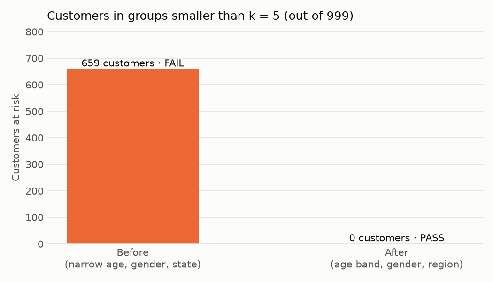
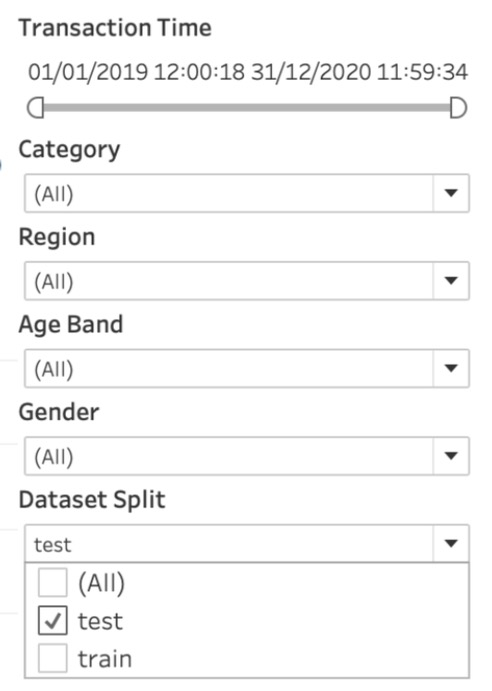
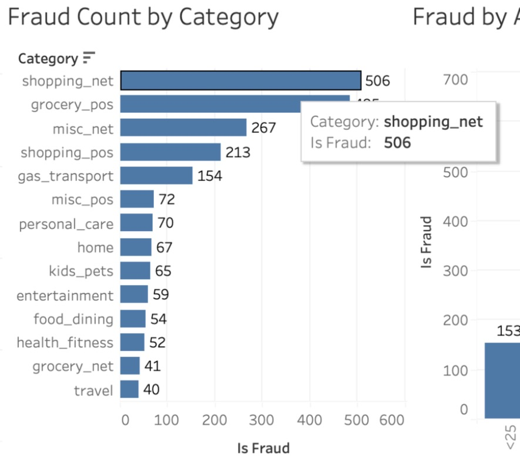

# Appendix A. Additional Screenshots

This appendix collects extra figures and listings that support Chapters 3 and 4.

## A.1 k-anonymity before and after generalization



**Figure A.1: Customers in groups smaller than k = 5 (out of 999). Before: narrow age band, gender and state (FAIL, 659 customers). After: age band, gender and region (PASS, 0 customers).**

## A.2 Threshold tuning on the training file

Contents of `outputs/rule_tuning.csv`, shown as a table.

| Threshold | Flagged | TP | FP | FN | TN | Precision | Recall | F1 | Accuracy |
|---|---|---|---|---|---|---|---|---|---|
| 1 | 530,962 | 7,208 | 523,754 | 298 | 765,415 | 0.0136 | 0.9603 | 0.0268 | 0.5958 |
| 2 | 108,984 | 5,411 | 103,573 | 2,095 | 1,185,596 | 0.0496 | 0.7209 | 0.0929 | 0.9185 |
| **3** | **9,357** | **3,934** | **5,423** | **3,572** | **1,283,746** | **0.4204** | **0.5241** | **0.4666** | **0.9931** |
| 4 | 1,485 | 1,237 | 248 | 6,269 | 1,288,921 | 0.8330 | 0.1648 | 0.2752 | 0.9950 |

**Table A.1: F1 score for each risk score threshold on the training file. Threshold 3 (bold) has the best F1 and was selected.**

## A.3 Project folder structure

```text
cbca-293-security/
├── pyproject.toml, uv.lock     uv project (Python 3.13)
├── .python-version             3.13
├── data/
│   ├── raw/                    fraudTrain.csv, fraudTest.csv (Kaggle)
│   └── processed/              transactions_protected.csv (Tableau input)
├── src/
│   ├── config.py               paths, salt, rule settings
│   ├── load_data.py            step 1: load, combine, clean, profile
│   ├── privacy.py              step 2: mask, hash, generalize, k-anonymity
│   ├── fraud_rules.py          steps 3-4: rules, score, metrics
│   ├── make_charts.py          step 5: report charts
│   ├── build_dashboard.py      step 6: writes the Tableau .twb
│   └── run_pipeline.py         runs steps 1-6 in order
├── outputs/                    JSON/CSV results, charts/*.png
├── dashboard/                  fraud_dashboard.twb, screenshots/
├── reports/                    00_front_matter.md ... 05_chapter5.md, appendix_a.md,
│                               presentation.md, assets/
└── docs/                       requirements, project understanding, decisions, plan
```

**Figure A.2: Project folder structure**

## A.4 Output files

| File | Size | Produced by | Content |
|---|---|---|---|
| `data/processed/transactions_protected.csv` | about 265 MB | `run_pipeline.py` | 1,852,394 protected rows, 19 columns |
| `outputs/data_profile.json` | 680 bytes | `load_data.py` | Dataset facts |
| `outputs/privacy_report.json` | 1,224 bytes | `privacy.py` | k-anonymity before and after, example record, removed columns |
| `outputs/rule_tuning.csv` | 294 bytes | `fraud_rules.py` | Train results for thresholds 1 to 4 |
| `outputs/metrics.json` | 1,562 bytes | `fraud_rules.py` | Learned settings and test metrics |
| `outputs/charts/fraud_rate_by_hour.png` | 38,360 bytes | `make_charts.py` | Figure 3.2 |
| `outputs/charts/fraud_rate_by_category.png` | 84,752 bytes | `make_charts.py` | Figure 3.3 |
| `outputs/charts/rule_comparison.png` | 43,885 bytes | `make_charts.py` | Figures 3.4 and 4.2 |
| `outputs/charts/confusion_matrix.png` | 37,315 bytes | `make_charts.py` | Figures 3.5 and 4.3 |
| `outputs/charts/k_anonymity_before_after.png` | 46,364 bytes | `make_charts.py` | Figures 3.6, 4.1 and A.1 |
| `dashboard/fraud_dashboard.twb` | 86,534 bytes | `build_dashboard.py` | Tableau workbook (12 worksheets, 6 calculated fields, 6 filters) |

**Table A.2: Files produced by one run of the pipeline**

## A.5 Additional Tableau screenshots

<!-- screenshot pending: capture after opening in Tableau -->


**Figure A.3: The filter panel (date range, category, region, age band, gender, dataset split)**

<!-- screenshot pending: capture after opening in Tableau -->


**Figure A.4: A tooltip on the Fraud Count by Category chart, showing protected fields only**
